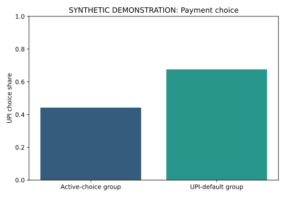

# Results walkthrough

All values below are synthetic or illustrative workflow results.

| Synthetic comparison | Probability-point change |
| --- | --- |
| Unadjusted group difference | 23.3093 |
| LPM Default coefficient | 22.358 |
| Logit average discrete change | 22.4228 |

These estimates describe 800 fictional records. Their agreement illustrates related summaries of the generated data, rather than reproducing the original academic study.

The numerical files in [demo_output](../demo_output/) are the authoritative bundled artifacts. Re-run the entry command to reproduce the workflow. Figure metadata can differ across renders even when the underlying numerical example is unchanged.
